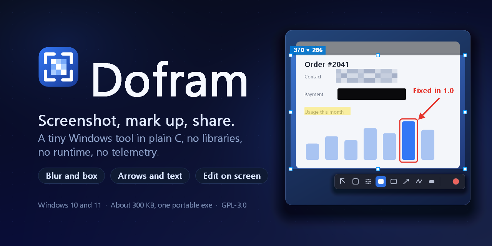
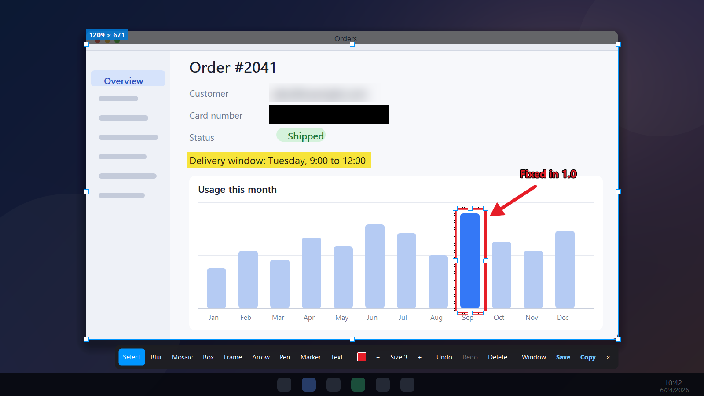
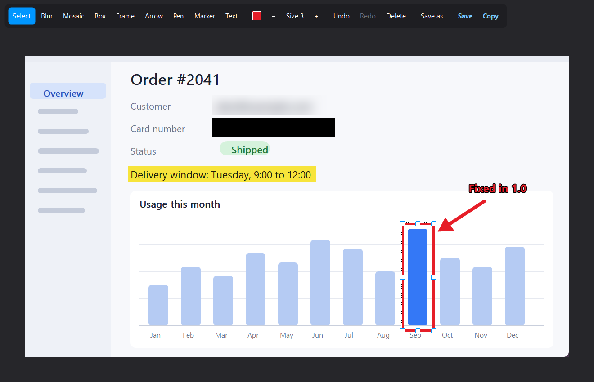

<p align="center">
  
</p>

<p align="center">
  A small, fast screenshot tool for Windows that lives in the tray. Freeze the screen, pick an area, mark it up right there, copy or save.
</p>

<p align="center">
  <a href="LICENSE"></a>
  <a href="https://github.com/dogukansahil/Dofram/releases/latest"></a>
  <a href="https://github.com/dogukansahil/Dofram/actions/workflows/build.yml"></a>
  
  
  
  
  
</p>

<p align="center">
  
</p>

## Why Dofram

- **One small file.** `Dofram.exe` is about 330 KB. There is no runtime, framework or browser engine to install, and it runs from any folder or a USB stick.
- **Written from scratch.** Plain C on the Win32 API and GDI+, both part of Windows. The editor, the pixel effects, the installer, the icon and even the README images are original code in this repository.
- **Edit where you captured.** The screen stays frozen after you select, and the tools appear next to the selection. Every mark stays an editable object until you finish: move it, resize it, recolour it.
- **Private by design.** No upload, no cloud, no account, no telemetry. Screenshots go only to your clipboard or your folder. Dofram goes online only when you pick *Check for Updates on GitHub*.
- **Redaction that holds.** The **Box** tool replaces the pixels underneath, so a hidden password or card number is really gone from the saved image.

## Features

- **Tray icon**: left-click captures an area; right-click opens the menu (capture area, all screens, capture in 3 seconds, open the screenshot folder, settings, install or uninstall, check for updates, about, exit).
- **Global hotkey**: <kbd>Ctrl</kbd>+<kbd>Shift</kbd>+<kbd>X</kbd> by default, any combination in Settings (including <kbd>PrintScreen</kbd>).
- **Frozen-screen selection**: all monitors freeze as they were when you pressed the hotkey, so menus and pop-ups can be captured too. Outside the selection the screen is dimmed, and an 8x magnifier with pixel coordinates follows the cursor.
  - Drag: select an area
  - Click: the whole monitor under the cursor
  - <kbd>Enter</kbd>: all monitors
  - <kbd>Esc</kbd> or right-click: cancel
- **Edit on the screen**: after selecting, the frozen screen stays and a toolbar appears next to the selection.
  - Drag the handles on the corners and edges of the selection to **resize the area**. With the **Select** tool, drag inside the area to move it, or drag outside it to draw a new one. Your objects stay where they are.
  - Every mark is an **object**: with **Select** (<kbd>V</kbd>) click a blur, box or arrow to **move** it, drag its handles to **resize** it, press <kbd>Delete</kbd> to remove it, use the arrow keys to nudge it by one pixel (<kbd>Shift</kbd> for 10). A new object is selected right away.
  - Change the colour and size of the selected object from the toolbar or with the mouse wheel.
  - **Window** opens the same image in a separate editor window.
- **Copy anywhere**: the clipboard gets both a bitmap and a PNG, so chat apps, office programs, Paint and browsers all accept it.
- **Save fast**: one key saves to your screenshot folder with a file name pattern; clicking the "Saved" notification opens the folder with the file selected.
- **Separate editor window** (optional): the same tools and objects, plus zoom, scrolling and **Save as** PNG, JPG or BMP. Closing with unsaved edits asks first.
- **Installs itself, or stays portable.** Run the downloaded file and choose *Install Dofram*, or keep using it as a portable app. See [Install](#install).
- **Updates on your terms.** *Check for Updates on GitHub* in the tray menu or the About box asks GitHub for the latest release number only when you pick it. Dofram never checks on its own and never downloads or installs anything.

### Tools

| Key | Tool | What it does |
| --- | --- | --- |
| <kbd>V</kbd> | Select | Move or resize objects and the area |
| <kbd>1</kbd> | Blur | Blurs the dragged area |
| <kbd>2</kbd> | Mosaic | Pixelates the dragged area |
| <kbd>3</kbd> | Box | Solid redaction box (black by default) |
| <kbd>4</kbd> | Frame | Rectangle outline |
| <kbd>5</kbd> | Arrow | Arrow; both ends can be dragged separately |
| <kbd>6</kbd> | Pen | Freehand line |
| <kbd>7</kbd> | Marker | Highlighter (multiplies with the colour, text stays readable) |
| <kbd>8</kbd> | Text | Click and type (<kbd>Enter</kbd> finishes, <kbd>Shift</kbd>+<kbd>Enter</kbd> new line); double-click text to edit it |

- Hold <kbd>Shift</kbd> while dragging a region to make it square.
- **Colour**: the colour swatch in the toolbar or <kbd>C</kbd> opens the palette; **More...** opens the full colour picker. Each tool remembers its own colour.
- **Size** 1 to 10 sets line width, blur strength, mosaic block size and text size together (mouse wheel, <kbd>[</kbd> <kbd>]</kbd>, or the toolbar's − and +).
- <kbd>Esc</kbd> or right-click while drawing or moving undoes that one action.

<p align="center">
  
</p>

## Keyboard shortcuts

| Action | Shortcut | Action | Shortcut |
| --- | --- | --- | --- |
| Capture an area | <kbd>Ctrl</kbd>+<kbd>Shift</kbd>+<kbd>X</kbd> (changeable) | Copy to the clipboard | <kbd>Ctrl</kbd>+<kbd>C</kbd> or <kbd>Enter</kbd> |
| Whole monitor / all monitors | click / <kbd>Enter</kbd> while selecting | Save to the folder | <kbd>Ctrl</kbd>+<kbd>S</kbd> |
| Select tool, tools 1 to 8 | <kbd>V</kbd>, <kbd>1</kbd> to <kbd>8</kbd> | Save as (editor window) | <kbd>Ctrl</kbd>+<kbd>Shift</kbd>+<kbd>S</kbd> |
| Colour palette | <kbd>C</kbd> | Undo / redo | <kbd>Ctrl</kbd>+<kbd>Z</kbd> / <kbd>Ctrl</kbd>+<kbd>Y</kbd> |
| Size down / up | <kbd>[</kbd> / <kbd>]</kbd> or mouse wheel | Extend the area to all monitors | <kbd>Ctrl</kbd>+<kbd>A</kbd> |
| Delete the selected object | <kbd>Delete</kbd> | Nudge the selected object | arrow keys (<kbd>Shift</kbd> for 10 px) |
| Zoom (editor window) | <kbd>Ctrl</kbd>+wheel, <kbd>Ctrl</kbd>+<kbd>+</kbd> / <kbd>-</kbd> | Fit / actual size (editor window) | <kbd>Ctrl</kbd>+<kbd>0</kbd> / <kbd>Ctrl</kbd>+<kbd>1</kbd> |
| Scroll (editor window) | wheel, <kbd>Shift</kbd>+wheel, drag empty space or middle mouse button | Close | <kbd>Esc</kbd> (first deselects the selected object) |

## Install

1. Download `Dofram.exe` from the [latest release](https://github.com/dogukansahil/Dofram/releases/latest). Each release also lists the file's SHA-256 checksum.
2. Run it. Dofram asks whether to install itself:
   - **Install Dofram** copies it to `C:\Program Files\Dofram`, adds a Start menu shortcut and registers it in *Settings > Apps > Installed apps*. Windows asks for administrator approval once.
   - **Run without installing** keeps using the downloaded file as a portable app. Tick *Don't ask me again* to stop the question.
3. The Dofram icon appears in the tray next to the clock. Right-click it and open **Settings...** to choose the hotkey, the screenshot folder and whether Dofram starts with Windows.
4. Press the hotkey, select an area, adjust it from its edges, mark it up, then <kbd>Ctrl</kbd>+<kbd>S</kbd> or <kbd>Ctrl</kbd>+<kbd>C</kbd>.

You can install later from the tray menu (**Install Dofram on This PC...**). To remove it, use *Settings > Apps > Installed apps* or **Uninstall Dofram...** in the tray menu; you can choose to delete your settings too. Your screenshots are never touched.

If you move a portable copy later, run it once by hand; it updates its start-up entry to the new location.

### Portable mode

If a file named `dofram.ini` (it may be empty) is next to `Dofram.exe`, Dofram keeps its settings there and never offers to install. Handy on a USB stick. Otherwise settings are kept in `%APPDATA%\Dofram\dofram.ini`. The file is plain UTF-8 text and can be edited by hand while Dofram is not running.

### Command line

```text
Dofram.exe                        start in the tray (if it is already running, start a capture)
Dofram.exe --capture              start a capture right away (starts Dofram first if needed)
Dofram.exe --tray                 start silently, without a notification (used by the start-up entry)
Dofram.exe --settings             open the settings window
Dofram.exe --portable             run without the install offer
Dofram.exe --install [--quiet]    install for all users (asks for elevation)
Dofram.exe --uninstall [--quiet]  remove the installation
```

Only one copy runs at a time. Starting it again does not open a second copy; it tells the running one to capture. The shortcuts made from Settings use `--capture`, so clicking a desktop shortcut or a pinned taskbar icon takes a screenshot directly.

## Settings

- Capture hotkey
- After selecting: **edit on the screen** (default), edit in a separate window, copy to the clipboard, save to the folder, or save and copy
- Screenshot folder (default `Pictures\Dofram`)
- File name pattern with `{date}`, `{time}` and `{ms}` (default `Dofram_{date}_{time}`); if the name exists, `_2`, `_3` and so on is added
- Format: PNG or JPG
- Start with Windows (silently, in the tray)
- Copy when saving, close the editor after saving or copying, notifications
- Starting tool (the last used tool and size are remembered too)
- Create a desktop or Start menu shortcut

## Build from source

Requirements: Windows 10 or 11 and the free [Build Tools for Visual Studio](https://visualstudio.microsoft.com/downloads/) (2019 or newer) with the *Desktop development with C++* workload. Nothing else is downloaded or linked; the C runtime is linked statically, so the result runs on a clean Windows.

```bat
git clone https://github.com/dogukansahil/Dofram.git
cd Dofram
build.bat
```

The result is `build\Dofram.exe`. Other targets:

```bat
build.bat test       :: release build, then the off-screen tests
build.bat debug      :: debug build
build.bat icon       :: redraw assets\dofram.ico from tools\makeicon.c
build.bat cover      :: redraw docs\images\cover.png from tools\mkcover.c
build.bat shots      :: redraw the README screenshots from tools\mkshots.c
build.bat clean      :: delete build\
```

The script finds the compiler with `vswhere`; it also works inside a *Developer Command Prompt*. Release builds use the compiler's security hardening (`/GS`, Control Flow Guard, ASLR, DEP). If `build\Dofram.exe` is running, the build stops and asks you to exit it from the tray menu first.

### Tests

`build.bat test` builds `tests\test_editor.c`, which drives the editor on hidden windows with synthetic mouse and keyboard calls (no real input is sent), checks the results and writes every rendered frame to `build\test\frames\` for a visual check. It also covers hotkey parsing, the settings file, the pixel effects, the settings dialog, command line parsing, the install decision and the update check's version handling, all without changing the system.

See [docs/ARCHITECTURE.md](docs/ARCHITECTURE.md) for how the code is organised.

## Project layout

```text
src/
  app.c              entry point, single instance, tray icon, hotkey, capture flow, About
  editor.c           the editor: frozen-screen overlay and separate window, toolbar, objects, undo
  ops.c              edit objects (blur, mosaic, box, frame, arrow, pen, marker, text) and geometry
  image.c            image buffers, screen capture, pixel effects, saving, clipboard
  settings.c         settings file and hotkey parsing
  settingsdlg.c      settings dialog and the key-combination box
  install.c          command line parsing and the self-installer
  update.c           the manual update check (WinHTTP)
  util.c             file names, folders, start-up entry, shortcuts, common dialogs
  gdip.h             the few GDI+ flat API declarations Dofram uses (plain C)
  version.h          version number used everywhere
  dofram.h           shared declarations
  dofram.rc          icon, manifest, version info, settings dialog layout
  dofram.manifest    visual styles, per-monitor DPI awareness
tests/
  test_editor.c      off-screen tests
tools/
  makeicon.c         draws the application icon
  mkcover.c          draws docs/images/cover.png
  mkshots.c          draws the README screenshots from made-up content
assets/              application icon (generated by tools/makeicon.c)
docs/                architecture notes, images
build.bat            build script (MSVC)
```

## Troubleshooting

- **The PrintScreen key does nothing**: Windows 11 gives this key to the Snipping Tool. Turn off *Settings > Accessibility > Keyboard > "Use the Print screen key to open screen capture"*, then restart Dofram.
- **"Could not register the hotkey"**: another program already uses that combination. Pick a different one in Settings.
- **The hotkey does not react while an elevated (administrator) window is in front**: Windows limits input from normal programs to elevated windows. Clicking the tray icon still works.
- **SmartScreen or UAC shows "unknown publisher"**: this is normal for executables without a code-signing certificate. Check the SHA-256 checksum on the release page, then choose *More info > Run anyway*.
- **Is blur safe for hiding information?** For passwords, card numbers or IDs use the **Box** tool. Blur and mosaic, especially at small sizes, can sometimes be partly reversed; a solid box cannot, because the pixels underneath are replaced.

## Roadmap

- [x] Frozen-screen capture over all monitors, per-monitor DPI aware
- [x] On-screen editing with movable, resizable objects
- [x] Separate editor window with zoom and Save as
- [x] Self-installing executable, portable mode
- [x] Manual update check
- [ ] Capture a single window by clicking it
- [ ] Numbered step markers
- [ ] Linux front end

Ideas and pull requests are welcome; please read [CONTRIBUTING.md](CONTRIBUTING.md) first.

## Privacy and security

- Screenshots stay on your computer: there is no upload, no account and no telemetry.
- The only network access is the update check you start yourself: one HTTPS request to `api.github.com` for the latest release number. Nothing is downloaded or run.
- Saved images contain only pixels, without metadata about you or your computer.
- Dofram runs with normal user rights; only installing and uninstalling ask for administrator approval.

Please report security problems privately, as described in [SECURITY.md](SECURITY.md).

## License

Dofram is free software: you can redistribute it and/or modify it under the terms of the [GNU General Public License version 3](LICENSE) (`GPL-3.0-only`). It comes with no warranty.

Copyright (C) 2026 Dogukan Sahil and Dofram contributors.

**Third-party material:** none is included. The source code, the application icon (drawn by `tools/makeicon.c`), the cover image (drawn by `tools/mkcover.c`) and the screenshots (drawn by `tools/mkshots.c` from made-up content) are original to this project. Dofram uses system components that ship with Windows (for example GDI+, WinHTTP and the Segoe UI font) without redistributing them. The Microsoft C runtime is linked statically by the compiler as a system library.

Names such as Windows and GitHub are trademarks of their respective owners. Dofram is an independent project and is not affiliated with or endorsed by them.

## Credits

Developed and maintained by Dogukan Sahil, with the help of the project's [contributors](https://github.com/dogukansahil/Dofram/graphs/contributors).
